# Does Wealth Burn Carbon? A Machine Learning Model Development and Evaluation Plan for Predicting Emissions Decoupling

*Week 3 Task - Machine Learning Model Development and Evaluation Plan (continuation of the Week 1 and Week 2 project)*

---

## 1. Introduction and problem framing

### 1.1 Where the project stands

This project asks whether rising income inevitably brings rising carbon dioxide (CO2) emissions. Week 1 proposed the data and visualisation strategy; Week 2 tested seven pre-specified hypotheses on Our World in Data (OWID) CO2 figures and World Bank indicators for 1990-2022. Its main findings, re-read from the result files, were: GDP per person and CO2 per person were strongly rank-correlated across 198 countries (Spearman rho = 0.85); high-income countries emitted about 14 times more per person than lower-middle and low-income countries combined; and 64% of high-income countries achieved absolute decoupling (income per person up, emissions per person down) between 1990 and 2022, against 5% to 20% in other income groups. The weakest result, a difference in income-emissions slopes by income group, lost significance without small countries (p = 0.013 in the main test, 0.074 without them).

Those tests described the past. Week 3 asks a forward-looking question suited to machine learning: **given what a country looks like in year t, will it decouple over the next three years?** The goal is a complete, honest model development plan, backed by working code.

### 1.2 The prediction task

One country in one year is an **observation** (a row). For country c and year t the **label** y is 1 if CO2 per person (OWID `co2_per_capita`, fossil fuels and industry) falls between t and t+3 **and** GDP per person (World Bank `NY.GDP.PCAP.KD`, constant 2015 US dollars) rises over the same period; otherwise y is 0. This is **absolute decoupling**. The inputs, called **features**, use only information available at the end of year t. A **model** is a function learned from past rows that outputs the probability that y = 1 for a new row. The task is **binary classification** on a **panel** (many countries over many years).

The aim is prediction, not explanation. A model can show which characteristics are *associated* with future decoupling, but not that changing them would *cause* it (Shmueli, 2010).

### 1.3 Success criteria fixed in advance

The pre-specification (`docs/ml_plan.md`, committed before any model was fitted) set three criteria. (1) The selected model should rank decoupling windows better than the base rate and better than a "persistence rule" that assumes the recent past continues; "better" means the 95% interval of the paired PR-AUC difference excludes zero (PR-AUC is explained in Section 6). (2) The pipeline must be free of leakage, meaning information from the test period or the future reaching the model; pytest checks test this (Appendix D). (3) Whatever the result, it is reported honestly: a modest result is acceptable, an inflated one is not.

### 1.4 Organisation

Sections 2 to 6 are the plan, Section 7 the implementation, Section 8 the results, Section 9 the risk register, and Sections 10 to 12 the limitations, roadmap and conclusion (Figure 1.1). The order of work is part of the evidence: the plan was committed first, exploration used only training years, the model was frozen, and the test years were evaluated once.

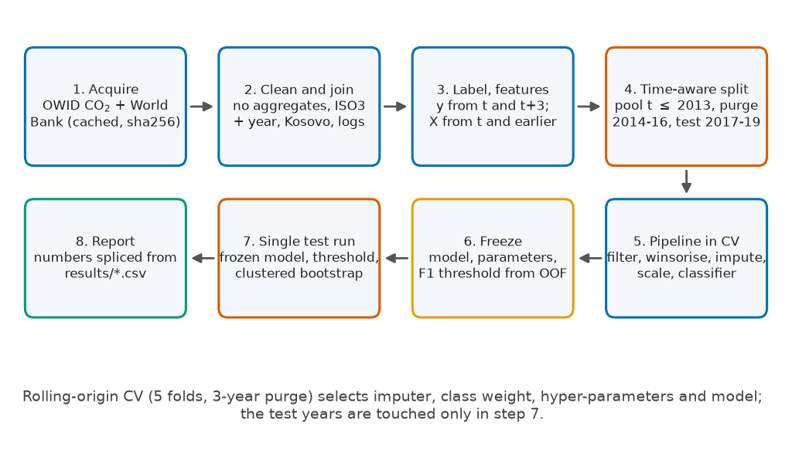

## 2. Dataset and label definition

### 2.1 Sources

Both public sources were used in Week 2: the OWID CO2 dataset with its codebook, and the World Bank Indicators API (version 2) for GDP per person, population, urbanisation, industry share and country metadata (income group, region). `src/acquire.py` downloads each file once, never overwrites it, and records URL, UTC time, size and SHA-256 hash in `data/raw/manifest.json`. All files were downloaded on 2026-11-05, so every number is tied to one data vintage.

The study window is 1990-2022. Five-year features need levels from five years earlier, so 1988 and 1989 are loaded as **look-back only**. Modelling rows start at t = 1993, and the last row with a three-year label is t = 2019. The codebook check (`results/column_availability.csv`) shows that 3 of the wanted energy columns do not exist in this dataset (`fossil_share_energy`, `low_carbon_share_energy`, `renewables_share_energy`); they were dropped from the feature list, not replaced.

### 2.2 From country-years to modelling rows

The cleaned panel has 8,015 country-year rows for 229 countries and territories: 7,245 present in both sources, 420 only in OWID and 350 only in the World Bank file. A row is **eligible** if CO2 per person and GDP per person are observed and strictly positive at t and at t+3. These core series are never imputed, because imputing the quantity that defines the label would put invented values inside the answer. Table 2.1 follows every exclusion; 5,283 rows are eligible in total (pool, purge years and test years).

**Table 2.1: Sample flow from all entity-years to eligible rows (h = 3).**

| Stage | Rows remaining | Rows dropped |
| :--- | ---: | ---: |
| all entity-years, t = 1993-2019 | 6,183 | 0 |
| no CO2 per capita > 0 at t | 5,765 | 418 |
| no GDP per capita > 0 at t | 5,294 | 471 |
| no CO2 per capita > 0 at t+3 | 5,294 | 0 |
| no GDP per capita > 0 at t+3 | 5,283 | 11 |

### 2.3 The label

The label uses only values at t and t+h (h = 3). The inequalities are strict: an unchanged value counts as neither falling nor rising.

```python
# from src/features.py
def make_label(grid: pd.DataFrame, h: int = H_DEFAULT) -> pd.DataFrame:
    """Label and eligibility for window start year t. Uses values at t and t+h only."""
    g = grid.sort_values(["iso3", "year"]).reset_index(drop=True)
    by = g["iso3"]
    out = g[["iso3", "year"]].copy()
    out["co2_t"], out["gdp_t"] = g["co2_pc"], g["gdp_pc"]
    out["co2_th"] = g["co2_pc"].groupby(by).shift(-h)
    out["gdp_th"] = g["gdp_pc"].groupby(by).shift(-h)
    out["y"] = ((out["co2_th"] < out["co2_t"]) & (out["gdp_th"] > out["gdp_t"])).astype(int)
    return out
```

Figure 2.1 shows the timeline. A row at t = 2013 already needs outcomes through 2016, which is why the split has a purge gap.

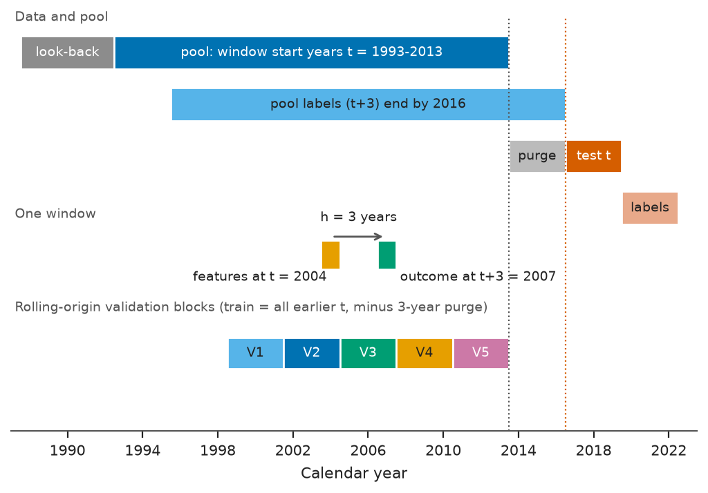

### 2.4 Base rate

The **base rate** is the share of rows with y = 1. In the training pool (4,093 rows, 201 countries) it is 26.8%, so about one window in four decouples. The yearly pool rate ranges from 17.0% (t = 1,993) to 37.2% (t = 2,011), moving with the world economy, which is one reason for a time-aware split. Over all eligible rows it is 26.5% and in the test years 24.9%. Table 8.1 lists every year and Figure 2.2 plots them. The pre-specified sanity range was 5% to 60%.

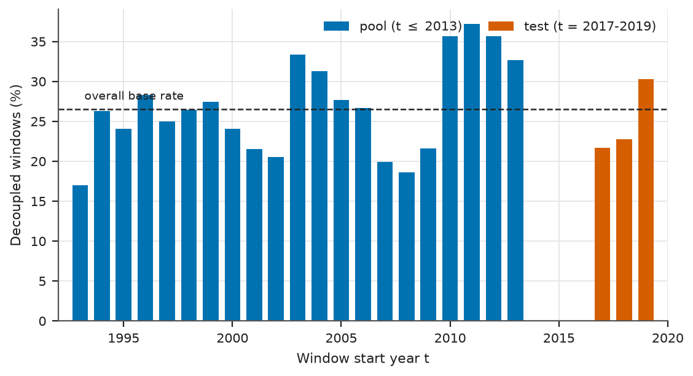

### 2.5 Why three years

One-year changes in emissions are noisy, so three years smooths some noise yet still gives many windows per country. The cost is that consecutive windows overlap by two years, so rows from one country are strongly dependent; hence all intervals resample whole countries, and a five-year horizon is a robustness variant (Section 8.8).

## 3. Data preparation

### 3.1 Cleaning rules carried over from Weeks 1 and 2

`src/clean.py` is a port of the Week 2 code (repositories linked in the README). Aggregates are removed (OWID rows without ISO3, World Bank region "Aggregates"); the join uses ISO3 plus year, never names, with one manual Kosovo crosswalk (`XKX`); legitimate extremes such as Qatar are kept; shares outside 0-100 become missing; logarithms use strictly positive values only; and every dropped or changed row is logged (Table 3.1). A few early CO2 values are zero (for example Kosovo in the 1990s); they stay in the panel, become missing in log-based features, and exclude rows whose label depends on them.

**Table 3.1: Cleaning log (step totals from `results/cleaning_log.csv`).**

| Step | Rule | Rows before | Rows after | Note |
| :--- | :--- | ---: | ---: | :--- |
| wb_meta | drop World Bank aggregates (region == Aggregates) | 296 | 217 |  |
| wb_ind:NY.GDP.PCAP.KD | keep country rows only | 9,310 | 7,595 | 546 null values kept as missing (not imputed) |
| wb_ind:SP.POP.TOTL | keep country rows only | 9,310 | 7,595 | 2 null values kept as missing (not imputed) |
| wb_ind:SP.URB.TOTL.IN.ZS | keep country rows only | 9,310 | 7,595 | 0 null values kept as missing (not imputed) |
| wb_ind:NV.IND.TOTL.ZS | keep country rows only | 9,310 | 7,595 | 1,322 null values kept as missing (not imputed) |
| owid_years | restrict to 1988-2022 | 50,411 | 8,879 |  |
| owid_crosswalk | manual crosswalk Kosovo -> XKX | 35 | 0 | rows changed (not dropped) |
| owid_agg | drop OWID rows with no ISO3 (aggregates, regions, shipping, aviation...) | 8,879 | 7,665 | 35 non-country entities |
| join | outer join OWID x World Bank on (iso3, year) | 15,260 | 8,015 | both=7,245, owid_only=420, wb_only=350 |
| range:urban_pct | shares outside 0-100 set to NaN | 7,595 | 7,595 |  |
| range:industry_pct | shares outside 0-100 set to NaN | 6,273 | 6,273 |  |
| logguard:co2_pc | non-positive values excluded from log transforms | 7,447 | 7,437 |  |
| logguard:gdp_pc | non-positive values excluded from log transforms | 7,049 | 7,049 |  |

### 3.2 Missingness audit

The audit uses only pool rows. 55% of pool rows have at least one missing feature, and 14 of the 20 features have some gaps (Figure 3.1, Table 3.2).

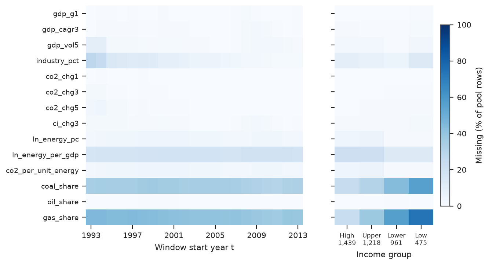

**Table 3.2: Missingness in the pool and its relation to observed country characteristics.**

| Feature | Missing in pool | Countries affected | p, missing vs income group (chi-square) | Median ln population, missing vs observed | p, population (Mann-Whitney) |
| :--- | ---: | ---: | ---: | ---: | ---: |
| gas_share | 41.2% | 98 | 2.7e-107 | 14.5 vs 16.2 | 5.9e-192 |
| coal_share | 34.2% | 83 | 4.3e-47 | 13.9 vs 16.1 | 1.2e-202 |
| ln_energy_per_gdp | 18.3% | 42 | 4.1e-09 | 12.2 vs 16.0 | 8.4e-277 |
| industry_pct | 8.5% | 59 | 5.7e-07 | 14.6 vs 15.8 | 5.3e-29 |
| ln_energy_pc | 3.5% | 12 | 8.7e-11 | 11.1 vs 15.7 | 1.2e-59 |
| co2_per_unit_energy | 3.5% | 12 | 8.7e-11 | 11.1 vs 15.7 | 1.2e-59 |
| gdp_vol5 | 2.2% | 30 | 1.7e-03 | 14.8 vs 15.7 | 1.6e-05 |
| ci_chg3 | 1.0% | 16 | 2.2e-01 | 13.7 vs 15.7 | 2.3e-08 |
| gdp_cagr3 | 0.8% | 12 | 2.0e-01 | 14.1 vs 15.6 | 1.3e-05 |
| co2_chg5 | 0.7% | 9 | 1.4e-02 | 13.6 vs 15.7 | 9.3e-10 |
| gdp_g1 | 0.3% | 11 | 9.0e-01 | 13.8 vs 15.6 | 9.1e-03 |
| co2_chg3 | 0.3% | 5 | 6.7e-02 | 13.6 vs 15.6 | 2.2e-04 |
| oil_share | 0.1% | 1 | 4.5e-03 | 13.6 vs 15.6 | n/a |
| co2_chg1 | 0.0% | 2 | 2.2e-01 | 14.1 vs 15.6 | n/a |

Data are **missing completely at random (MCAR)** if missingness is unrelated to anything, **missing at random (MAR)** if it depends only on observed variables such as income group, and **missing not at random (MNAR)** if it depends on the missing value itself or on unobserved circumstances. The gaps here are not MCAR: 9 of the 14 affected features differ significantly by income group, and the larger gaps (fuel shares, energy intensity) are concentrated in poorer countries. Small states and conflict-affected countries are probably MNAR, which cannot be tested and which no imputation fully repairs. The response is to give models the fact of missingness (indicator flags) and to show subgroup results (Section 8.7).

### 3.3 Imputation options

**Imputation** fills a missing value with an estimate. Four options were compared by cross-validation: (1) **median plus missing-indicator flags**, using the training-fold median and an extra 0/1 column; (2) **within-country forward fill (at most two years), then median**, which uses only past values and is applied to raw level series other than CO2 and GDP; (3) **iterative imputation** (`IterativeImputer` with `BayesianRidge`), which predicts each gappy feature from the others; and (4) **native NaN handling** in `HistGradientBoostingClassifier`, which learns which branch missing values should follow.

### 3.4 Scaling, transformation and outliers

Skewed positive variables enter as natural logarithms, and growth and momentum features are differences of logarithms. The pipeline **winsorises** each feature, clipping values below the 1st or above the 99th percentile to those percentiles, with limits learned on the training fold only. `StandardScaler` (subtract the mean, divide by the standard deviation) is used for the logistic regression only, because its penalty needs comparable scales. Tree models split on thresholds and are unchanged by monotone rescaling.

### 3.5 Class imbalance

About three rows in four are negatives, so always predicting "no decoupling" scores high accuracy. Two remedies were compared: no weighting, and `class_weight="balanced"`, which weights each row's loss by the inverse frequency of its class. **SMOTE** (synthetic minority oversampling) was deliberately not used: it interpolates between neighbouring minority rows, and on a panel those neighbours come from different countries and years, which blurs the temporal structure and can place information from later years beside earlier ones.

### 3.6 Encoding and the pipeline

All 20 features are numeric, so no encoding is needed; country, income group and region are not features (Section 4.3), and a categorical feature would be one-hot encoded inside the pipeline.

Every step that learns from data (filter, winsorising limits, imputer, scaler, model) belongs to one scikit-learn `Pipeline`, refitted on each training fold, so it never sees validation or test rows. The Winsorizer is representative.

```python
# from src/models.py
class Winsorizer(TransformerMixin, BaseEstimator):
    """Clip each column to its [lower, upper] percentiles learned on the training fold (NaN-safe)."""

    def __init__(self, lower: float = 1.0, upper: float = 99.0):
        self.lower = lower
        self.upper = upper

    def fit(self, X, y=None):
        X = validate_data(self, X, ensure_all_finite="allow-nan", reset=True)
        lo = np.full(X.shape[1], -np.inf)
        hi = np.full(X.shape[1], np.inf)
        for j in range(X.shape[1]):
            col = X[:, j]
            col = col[~np.isnan(col)]
            if len(col):
                lo[j], hi[j] = np.percentile(col, [self.lower, self.upper])
        self.lo_, self.hi_ = lo, hi
        return self

    def transform(self, X):
        X = validate_data(self, X, ensure_all_finite="allow-nan", reset=False)
        return np.clip(X, self.lo_, self.hi_)

    def get_feature_names_out(self, input_features=None):
        return np.asarray(input_features if input_features is not None else self.feature_names_in_, dtype=object)
```

## 4. Feature engineering

### 4.1 Feature extraction

The design follows the **Kaya identity**: CO2 per person equals GDP per person times energy per unit of GDP times CO2 per unit of energy. Because the label concerns CO2 per person and GDP per person, these three factors are the natural drivers of whether it turns on. The 20 features fall into three groups: economic structure and growth, emissions and momentum, and energy and fuel mix. Changes are differences of natural logarithms, so -0.05 means a fall of about 5%, and every feature at year t uses data from t and earlier. Table 4.1 gives the expected signs written in the plan before any model was fitted; Appendix C adds summary statistics.

**Table 4.1: Feature catalogue (all features use data up to year t).**

| Feature | Group | Definition | Why it matters | Expected sign |
| :--- | :--- | :--- | :--- | :--- |
| ln_gdp_pc | economic | ln GDP per capita (constant 2015 US$) | Richer economies have more room for structural change. | + |
| gdp_g1 | economic | 1-year change in ln GDP per capita | Decoupling needs growth to continue; recent growth is persistent. | + |
| gdp_cagr3 | economic | 3-year average annual change in ln GDP per capita | Medium-run growth trend. | + |
| gdp_vol5 | economic | standard deviation of the last five 1-year growth rates | Unstable economies rarely decouple steadily. | - |
| ln_pop | economic | ln population | Scale of the country; weak prior. | ? |
| pop_g3 | economic | 3-year average annual change in ln population | Fast population growth raises energy demand. | - |
| urban_pct | economic | urban population share (%) | Stage of development. | ? |
| industry_pct | economic | industry value added (% of GDP) | Industry-heavy economies are harder to decarbonise. | - |
| ln_co2_pc | emissions | ln CO2 per capita | A high emitter has more to cut. | + |
| co2_chg1 | emissions | 1-year change in ln CO2 per capita | Emission momentum: recent falls tend to persist. | - |
| co2_chg3 | emissions | 3-year change in ln CO2 per capita | Medium-run emission momentum. | - |
| co2_chg5 | emissions | 5-year change in ln CO2 per capita | Long-run emission momentum. | - |
| ln_co2_per_gdp | emissions | ln of CO2 per unit of GDP | Carbon intensity of output (Kaya term). | - |
| ci_chg3 | emissions | 3-year change in ln CO2 per unit of GDP | Carbon-intensity momentum. | - |
| ln_energy_pc | energy mix | ln primary energy per capita (OWID) | Energy use level. | ? |
| ln_energy_per_gdp | energy mix | ln energy per unit of GDP (OWID) | Energy intensity of output (Kaya term). | - |
| co2_per_unit_energy | energy mix | CO2 per unit of primary energy (g/kWh, OWID) | Carbon intensity of energy (Kaya term). | - |
| coal_share | energy mix | coal CO2 divided by total CO2 | Coal-heavy systems decouple less easily. | - |
| oil_share | energy mix | oil CO2 divided by total CO2 | Transport-heavy fuel mix; direction unclear. | ? |
| gas_share | energy mix | gas CO2 divided by total CO2 | Gas often replaces coal. | + |

Two features are exact linear combinations of others: log carbon intensity equals log CO2 per person minus log GDP per person, and its 3-year change equals the 3-year CO2 change minus three times the 3-year growth rate. They were kept because they give tree models a ready-made ratio and the elastic-net penalty copes with exact collinearity, but the variance inflation factor flags them.

### 4.2 Feature sets for ablation

Three nested sets were fixed in advance to show where information comes from: A is **momentum only**, B adds economic structure, and C is the full set including energy and fuel mix.

| Set | Features | Members |
| :--- | ---: | :--- |
| A | 6 | `co2_chg1`, `co2_chg3`, `co2_chg5`, `ci_chg3`, `gdp_g1`, `gdp_cagr3` |
| B | 14 | `co2_chg1`, `co2_chg3`, `co2_chg5`, `ci_chg3`, `gdp_g1`, `gdp_cagr3`, `ln_gdp_pc`, `gdp_vol5`, `ln_pop`, `pop_g3`, `urban_pct`, `industry_pct`, `ln_co2_pc`, `ln_co2_per_gdp` |
| C | 20 | `ln_gdp_pc`, `gdp_g1`, `gdp_cagr3`, `gdp_vol5`, `ln_pop`, `pop_g3`, `urban_pct`, `industry_pct`, `ln_co2_pc`, `co2_chg1`, `co2_chg3`, `co2_chg5`, `ln_co2_per_gdp`, `ci_chg3`, `ln_energy_pc`, `ln_energy_per_gdp`, `co2_per_unit_energy`, `coal_share`, `oil_share`, `gas_share` |

### 4.3 What is deliberately excluded

**Calendar year** would let a flexible model memorise year-specific base rates and then extrapolate to unseen years. **Country identity** would turn the task into memorising countries instead of generalising to new ones. **World Bank income group** is defined by a threshold on national income, so it is circular with GDP per person; the classification used here is also the current one, not the one in force in year t, so it would carry information from the future into past rows. Income group and region are used only to evaluate subgroups.

### 4.4 Feature selection

**Filter: near-duplicates and collinearity.** Inside every training fold, features are visited in the order of Table 4.1 and one is dropped if its absolute Spearman rank correlation with an already kept feature exceeds 0.9. On the whole pool this removed 1 feature, `ln_energy_pc` (rho = 0.97 with `ln_co2_pc`): countries that emit more per person use more energy per person (Figure 4.1). The **variance inflation factor (VIF)** measures how well each feature is predicted by the others; values above about 10 signal troublesome collinearity (Table 4.2). By the identities above, 3 features have an infinite VIF (`ln_gdp_pc`, `ln_co2_pc`, `ln_co2_per_gdp`), and the 3-year momentum features are large but finite (18.8 for `co2_chg3`, 18.8 for `ci_chg3`).

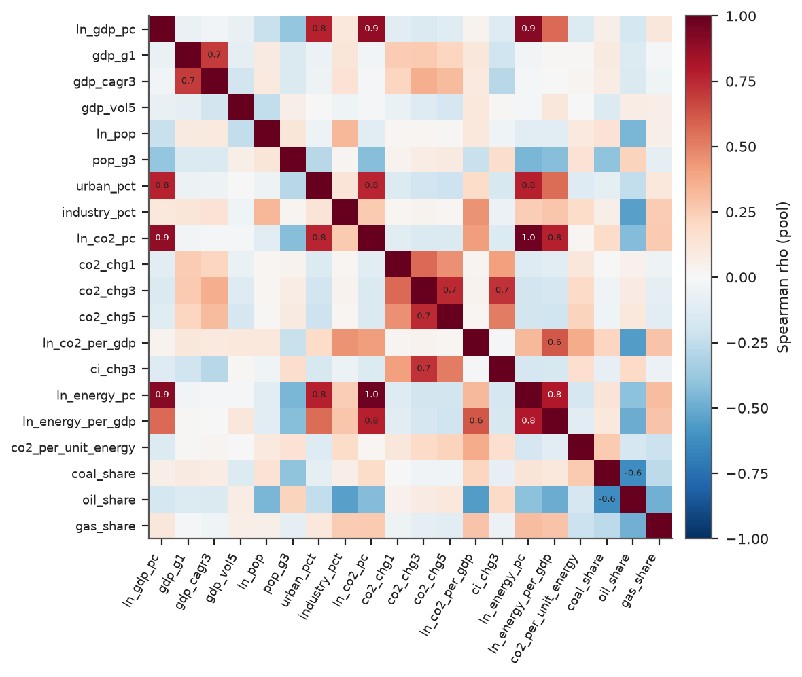

**Table 4.2: Variance inflation factors on the pool (median-imputed, standardised).**

| Feature | VIF, all 20 features | VIF after the near-duplicate filter |
| :--- | ---: | ---: |
| ln_gdp_pc | infinite | infinite |
| gdp_g1 | 2.0 | 2.0 |
| gdp_cagr3 | 9.9 | 9.7 |
| gdp_vol5 | 1.2 | 1.2 |
| ln_pop | 2.1 | 2.0 |
| pop_g3 | 1.4 | 1.4 |
| urban_pct | 3.0 | 3.0 |
| industry_pct | 1.6 | 1.6 |
| ln_co2_pc | infinite | infinite |
| co2_chg1 | 1.4 | 1.4 |
| co2_chg3 | 18.8 | 18.6 |
| co2_chg5 | 2.3 | 2.3 |
| ln_co2_per_gdp | infinite | infinite |
| ci_chg3 | 18.8 | 18.6 |
| ln_energy_pc | 32.5 | dropped by filter |
| ln_energy_per_gdp | 4.9 | 3.8 |
| co2_per_unit_energy | 2.3 | 1.9 |
| coal_share | 3.2 | 3.2 |
| oil_share | 6.2 | 6.1 |
| gas_share | 2.5 | 2.5 |

**Embedded selection.** The L1 part of the elastic-net penalty shrinks weak coefficients to exactly zero, so the fitted model is itself a selector; a variant with an L1 `SelectFromModel` step is compared in the ablation. **Permutation importance** shuffles one feature at a time in held-out data and records the fall in PR-AUC; it is computed on each validation block and, descriptively, on the test set. **Recursive feature elimination (RFE)** was considered but not used: it refits the model repeatedly inside every fold, is unstable with correlated features, and adds one more tuned setting.

### 4.5 Leakage review

Leakage is a widespread cause of unreliable results in machine-learning studies (Kapoor & Narayanan, 2023), so each feature was checked against three questions: does it use data after t, does it use a label-defining quantity from t+1 or later, and does it use a classification that depends on the future? None does. Pytest checks perturb all data after a cut-off and confirm that earlier features do not change (Appendix D, test 13), and that forward fill uses only past values (test 15).

## 5. Algorithm selection

### 5.1 Candidates and baselines

Two baselines set the bar. The **prior (majority) baseline** gives every row the training base rate, so its PR-AUC equals the share of positives. The **persistence rule** predicts decoupling when CO2 per person fell and GDP per person rose over the previous three years (and no decoupling if either is unknown); a learned model is only useful if it beats it. Three algorithms were trained and three more considered but not trained, all from scikit-learn with `random_state = 42` (Table 5.1).

**Table 5.1: Algorithm comparison.**

| Algorithm | Strengths | Limitations | Assumptions | Status in this project |
| :--- | :--- | :--- | :--- | :--- |
| Elastic-net logistic regression | Interpretable coefficients; convex; fast; L1 part selects features, L2 part handles correlated features; probabilities are well-behaved | Linear in the features, so interactions and thresholds are missed; needs scaling and imputation | Linear log-odds; independent rows (violated here, handled by clustered resampling) | Trained; kept as the interpretable model |
| Random forest | Captures non-linearity and interactions; robust to outliers and scale; few settings to tune | Probabilities are less calibrated; less interpretable; cannot extrapolate | None on functional form; assumes rows are exchangeable | Trained |
| Histogram gradient boosting (HGB) | Strong on tabular data; native NaN handling; regularisation options | More hyper-parameters; sensitive to noise when signal is weak; sequential, harder to explain | None on functional form | Trained |
| Support vector machine (RBF) | Flexible margin classifier | Needs scaling; probabilities need extra calibration; training cost grows quickly with rows; no native missing handling; kernel choice hard to interpret | Smooth decision boundary | Not trained |
| k-nearest neighbours | Simple, non-parametric | Distances are dominated by a few scales in 20 mixed features; rows of one country are near-duplicates, so neighbours leak across time; no feature importance | Meaningful distance | Not trained |
| Neural network (MLP) | Flexible function approximator | About four thousand rows of noisy tabular data is too small to justify it; extra tuning and instability; weak interpretability | Smooth function; scaled inputs | Not trained |

### 5.2 Rationale for the trained models

**Elastic-net logistic regression** models the log-odds of decoupling as a weighted sum of features. Its penalty blends an L1 term (which can set weights to zero) and an L2 term (which shares weight among correlated features), a recognised remedy for collinear predictors (Zou & Hastie, 2005). Its standardised coefficients state direction and size and can be compared with the expected signs; its limit is linearity.

**Random forest** averages many decision trees, each grown on a bootstrap sample with a random subset of features at each split (Breiman, 2001). It captures thresholds and interactions without scaling, but its probabilities are usually less well calibrated and it cannot extrapolate.

**Histogram gradient boosting (HGB)** builds trees one after another, each correcting the errors of the earlier ones (Friedman, 2001), on binned feature values. It often does best on tabular data and handles missing values natively, but it has more settings and can fit noise when the signal is weak.

The support vector machine, k-nearest neighbours and neural network were not trained, for the reasons in Table 5.1.

### 5.3 The decision rule

The final choice was made by a rule fixed before looking at results. **Pick the model with the highest mean PR-AUC across the five rolling-origin folds; if a simpler model is within one standard error of the best, choose the simpler one.** The complexity order is logistic regression, random forest, HGB. With few folds and dependent windows, small score differences are hard to tell from noise, and a simpler model is easier to explain. The deliverable is the chosen model plus the interpretable logistic baseline; if they coincide, as they did (Section 8.3), the best non-linear model is still evaluated as a reference.

### 5.4 Hyper-parameters and the two-stage search

Hyper-parameters are settings fixed before fitting, such as penalty strength. The search spaces are small and set in advance (Appendix B). **Stage 1** fixes the preprocessing: for each model every combination of imputation and class weighting is scored with default hyper-parameters, and the rule above picks one, preferring simpler preprocessing (native NaN handling, then median, forward fill, iterative; no weights before balanced weights). **Stage 2** runs `RandomizedSearchCV` with 30 random draws per model, scored by mean PR-AUC on the same folds. HGB's early stopping is switched off, because its internal validation split is random and ignores time order.

## 6. Evaluation strategy

### 6.1 Splits: pool, purge and test

The split is by time: a random split would put a country's 2010 row in training and its 2011 row in validation, and since those windows share two years of outcomes the model would be graded partly on what it had seen. The design (Figure 2.1) is: **pool** (training and selection) with t = 1993 to 2013, labels ending by 2016; a **purge gap** of t = 2014 to 2016, unused because those windows would overlap the test period; and **test** with t = 2017, 2018, 2019 (labels ending 2020 to 2022). The test set informs no choice: not features, imputer, winsorising limits, model, hyper-parameters or threshold.

### 6.2 Cross-validation inside the pool

**Cross-validation (CV)** repeatedly splits training data into a fitting part and a scoring part, so choices can be made without the test set. Time-ordered data need blocks that respect time (Bergmeir & Benitez, 2012; Cerqueira et al., 2020), and grouped data such as countries make random splits too optimistic (Roberts et al., 2017). The primary scheme is **rolling-origin (expanding-window) CV** with five folds: validation blocks of three consecutive years (1999-2001 to 2011-2013) and, for a block starting in year v, training rows with t at most v minus 4, leaving a three-year purge gap. Table 6.1 lists the folds; the first has only 569 training rows and a noisier score.

**Table 6.1: Rolling-origin folds (years are window start years).**

| Fold | Training years t | Validation years t | Training rows | Validation rows | Positives in validation | Validation base rate |
| :--- | ---: | ---: | ---: | ---: | ---: | ---: |
| 1 | 1993-1995 | 1999-2001 | 569 | 583 | 142 | 24.4% |
| 2 | 1993-1998 | 2002-2004 | 1,145 | 585 | 166 | 28.4% |
| 3 | 1993-2001 | 2005-2007 | 1,728 | 586 | 145 | 24.7% |
| 4 | 1993-2004 | 2008-2010 | 2,313 | 597 | 151 | 25.3% |
| 5 | 1993-2007 | 2011-2013 | 2,899 | 597 | 210 | 35.2% |

A **secondary check** uses `GroupKFold`: five folds with no country on both sides, which measures generalisation to unseen countries. It ignores time, so it is optimistic and never used to select.

### 6.3 Metrics

A **confusion matrix** counts true positives (TP), false positives (FP), true negatives (TN) and false negatives (FN) for hard predictions. Table 6.2 defines each metric. The **selection metric** is PR-AUC: the precision-recall curve is more informative than the ROC curve when positives are the minority (Davis & Goadrich, 2006; Saito & Rehmsmeier, 2015), and a model with no skill scores the base rate. Accuracy is reported but flagged as misleading. The Matthews correlation coefficient is preferred to F1 or accuracy as a one-number summary because it uses all four cells of the confusion matrix (Chicco & Jurman, 2020).

**Table 6.2: Metrics, definitions and purpose.**

| Metric | Definition | Why it is used here |
| :--- | :--- | :--- |
| PR-AUC (average precision) | Area under the precision-recall curve; mean precision weighted by the increase in recall | Selection metric: focuses on the positive (decoupled) class, so abundant true negatives cannot flatter it |
| ROC-AUC | Probability that a random positive window is scored above a random negative one | Threshold-free ranking quality; reported next to PR-AUC |
| Accuracy | Share of correct predictions | Reported but flagged as misleading when about three quarters of rows are negatives |
| Balanced accuracy | Mean of recall and specificity | Not driven by class sizes |
| Precision | True positives divided by predicted positives | How many alarms are correct |
| Recall | True positives divided by actual positives | How many decoupling windows are found |
| F1 | Harmonic mean of precision and recall | Used only for the single threshold rule |
| MCC | Correlation between predicted and actual classes, from the whole confusion matrix | Balanced summary that is not inflated by imbalance |
| Brier score | Mean squared error of the predicted probability | Quality of the probabilities themselves |
| ECE | Weighted mean gap between predicted probability and observed frequency over 10 equal-width bins | Calibration summary; shown with a reliability curve |

### 6.4 Decision threshold

A **threshold** turns a probability into a yes or no. The single rule is: take the value that maximises F1 on the **pooled out-of-fold predictions** of the CV (every pool row predicted by a model that did not train on it), compute it once and freeze it in `results/frozen_config.json` before the test run. The rule has a known weakness: when the model separates classes only weakly, the F1-maximising threshold falls so low that nearly every row is flagged. PR-AUC and ROC-AUC do not depend on the threshold, so they carry the main conclusions.

### 6.5 Calibration

A model is **calibrated** if, among rows given probability 0.3, about 30% are positive; some model families distort this (Niculescu-Mizil & Caruana, 2005). It is assessed with a reliability curve (10 equal-width bins), the **expected calibration error (ECE)** and the Brier score. No recalibration is applied.

### 6.6 Uncertainty

A row-level bootstrap would give intervals that are too narrow for dependent rows. The **bootstrap** re-estimates a statistic on many resamples (Efron, 1979); here whole countries are resampled with replacement, keeping every window of a chosen country, and all 95% intervals are percentile intervals from 2,000 resamples. To compare two models the same resampled countries score both and the **paired difference** in PR-AUC is summarised; an interval excluding zero means the difference is unlikely to be noise.

### 6.7 Subgroups, interpretation and ablation

On the test set, performance is split by World Bank income group (the *current* classification, used only for evaluation) and region, with row and positive counts shown. Interpretation uses permutation importance, standardised logistic coefficients and partial dependence (the average predicted probability as one feature varies while the others keep their observed values). Findings are at country level (an **ecological** reading that says nothing about individuals or regions inside a country), and income level is not independent of GDP, which is a feature. The **ablation** refits the chosen model with feature sets A, B, C and an L1-selected C, with fixed tuned hyper-parameters.

### 6.8 Robustness variants

Three variants are saved as separate files: a five-year horizon (CV with a five-year purge, pool ending at t = 2011, four folds); excluding the window ending in 2020 (t = 2017), which is affected by COVID-19; and excluding countries under one million people. The last two are subsets of the one test run.

### 6.9 Discipline around the test set

Only `src/evaluate_test.py` calls the function that returns the test years. It reads the frozen configuration, refuses to run if `results/test_run_lock.json` exists, and writes the lock when it finishes. Pytest checks fail if the CV code refers to the test accessor, and confirm that the configuration predates the lock and that the stored threshold reproduces the reported confusion matrix.

## 7. Implementation

### 7.1 Repository and order of work

`src/acquire.py` and `src/clean.py` build the data, `src/features.py` features, labels and splits, `src/models.py` the pipelines, `src/metrics.py` metrics and bootstrap, `src/evaluate_cv.py` the training-period analysis and selection, `src/evaluate_test.py` the single test run and `src/make_figures.py` the figures. The commit history shows the order: plan first, then acquisition and cleaning, features and splits, cross-validation with the frozen configuration, and last the test run, figures and report. Numbers in this document are not typed by hand: `report/_build/build_report.py` splices them from the result files and fails if a value does not exist.

### 7.2 Pipeline architecture

The factory chains near-duplicate filter, winsorising, imputation, scaling (logistic regression only), an optional L1 selector and the classifier. The one custom selector is fitted on the training fold only.

```python
# from src/models.py
def make_pipeline(model: str, imputer: str = "median", class_weight=None, params: dict | None = None,
                  corr_filter: bool = True, l1_select: bool = False) -> Pipeline:
    """Pipeline: correlation filter -> winsorise -> impute -> (scale for LR) -> [L1 select] -> classifier.

    `imputer` in {"median", "ffill_median", "iterative", "native"}; "ffill_median" differs from "median" only in the
    input data (the dataset is built with ffill=True), the pipeline is identical. "native" is allowed for HGB only.
    """
    params = params or {}
    steps: list[tuple[str, object]] = []
    if corr_filter:
        steps.append(("corr_filter", CorrelationFilter(0.9)))
    steps.append(("winsorise", Winsorizer(1.0, 99.0)))
    if imputer in ("median", "ffill_median"):
        steps.append(("impute", SimpleImputer(strategy="median", add_indicator=True)))
    elif imputer == "iterative":
        steps.append(("impute", IterativeImputer(estimator=BayesianRidge(), max_iter=10, random_state=SEED,
                                                 sample_posterior=False, add_indicator=True)))
    elif imputer == "native":
        if model != "hgb":
            raise ValueError("native NaN handling is only available for HGB")
    else:
        raise ValueError(imputer)
    if model == "lr":
        steps.append(("scale", StandardScaler()))
    if l1_select:
        steps.append(("l1_select", SelectFromModel(
            LogisticRegression(solver="saga", l1_ratio=1.0, C=0.1, max_iter=5000, random_state=SEED))))
    steps.append(("clf", _estimator(model, params, class_weight)))
    return Pipeline(steps)
```

```python
# from src/models.py
class CorrelationFilter(TransformerMixin, BaseEstimator):
    """Greedy near-duplicate filter. Features are visited in column order; a feature is dropped when its
    |Spearman rho| with an already kept feature exceeds `threshold`. Fitted on the training fold only."""

    def __init__(self, threshold: float = 0.9):
        self.threshold = threshold

    def fit(self, X, y=None):
        X = validate_data(self, X, ensure_all_finite="allow-nan", reset=True)
        rho = pd.DataFrame(X).corr(method="spearman", min_periods=20).abs().fillna(0.0).to_numpy()
        keep: list[int] = []
        for j in range(X.shape[1]):
            if all(rho[j, k] <= self.threshold for k in keep):
                keep.append(j)
        self.keep_ = np.array(keep)
        self.dropped_ = np.array([j for j in range(X.shape[1]) if j not in set(keep)])
        return self

    def transform(self, X):
        X = validate_data(self, X, ensure_all_finite="allow-nan", reset=False)
        return X[:, self.keep_]

    def get_feature_names_out(self, input_features=None):
        names = np.asarray(input_features if input_features is not None else self.feature_names_in_, dtype=object)
        return names[self.keep_]
```

### 7.3 Time-aware folds

This generator enforces the purge gap: each validation block keeps only training rows whose three-year label window ends before the block begins.

```python
# from src/features.py
def rolling_origin_folds(pool: pd.DataFrame, h: int = H_DEFAULT, n_folds: int = 5):
    """Expanding-window folds with a purge gap of h years.

    For a validation block starting at year v the training rows are those with t <= v - h - 1,
    so every training label window (t .. t+h) ends before v.
    Returns a list of (train_positions, validation_positions) into `pool`.
    """
    yr = pool["year"].to_numpy()
    folds = []
    for lo, hi in fold_blocks(h, n_folds):
        tr = np.where(yr <= lo - h - 1)[0]
        va = np.where((yr >= lo) & (yr <= hi))[0]
        folds.append((tr, va))
    return folds
```

### 7.4 Search and freeze

`RandomizedSearchCV` receives the rolling-origin index pairs as its `cv` argument, so tuning uses exactly the planned folds.

```python
# from src/evaluate_cv.py (stage 2, abridged)
search = RandomizedSearchCV(M.make_pipeline(m, imp, cw), M.GRIDS[m], n_iter=M.N_ITER,
                            scoring="average_precision", cv=folds, random_state=M.SEED,
                            n_jobs=N_JOBS, refit=False, error_score="raise")
search.fit(P[F.FEATURES], y)
```

Out-of-fold predictions then feed the selection rule and the F1 threshold, and everything is written to `results/frozen_config.json` with a hash of the out-of-fold file, which the test script checks before it starts.

### 7.5 Integrity tests and deviations

A pytest suite of 31 checks covers data hygiene, label construction on hand-made examples, absence of look-ahead, the split design, fitting on training folds only, reproducibility and the single-test-run discipline (Appendix D); all pass on the final commit. Changes to the plan are allowed only in a dated section appended to it. Those entries are listed in full below; the first five were made before the test run and none touched the test set.

| No. | Entry appended to docs/ml_plan.md (2026-11-05) |
| ---: | :--- |
| 1 | `src/evaluate_cv.py` was run twice. The first run wrote duplicate rows into `results/robustness_cv.csv` (the chosen model and the logistic baseline are the same model, so one row was written twice). The loop was fixed to de-duplicate and the script re-run. All fitted numbers, the selection and the frozen threshold were identical in both runs. |
| 2 | The saga solver of the elastic-net logistic regression reached `max_iter = 5000` without full convergence for some large-`C` candidates inside the randomised search (a convergence warning, suppressed in the logs). The grid was not changed; the selected configuration (`C = 3`) is reported as fitted. |
| 3 | `IterativeImputer` printed convergence warnings with `max_iter = 10` and `BayesianRidge`; they are suppressed and `max_iter` was not changed. The option did not win the pre-specified selection rule for any model. |
| 4 | `src/evaluate_test.py` has a `--rehearsal` mode that runs the same code on a pseudo-split carved out of the pool (train `t <= 2005`, pseudo-test `t = 2009-2011`) to debug the script without opening the test labels. Its outputs are git-ignored. |
| 5 | The plan describes a "simpler model within one standard error" rule. The standard error is the fold-to-fold standard deviation divided by the square root of five; with five temporally dependent folds this is a rough yardstick. It is used exactly as pre-specified. |
| 6 | The single test run (`src/evaluate_test.py`, lock file written 2026-11-05 12:47:59 UTC) selected nothing and changed nothing. Because the pre-specified rule chose the logistic regression, the script's list of paired test comparisons (chosen versus logistic baseline) was degenerate and omitted LR versus the random forest and HGB. These comparisons were added afterwards as a clearly labelled **post-hoc, exploratory** analysis by `src/posthoc_test_analysis.py`, which only reads the saved test predictions (no model is refitted and the test set is not re-evaluated). The same script scores the test rows with an income-group prior (the pool base rate of each World Bank income group) to show how much of the skill is group-level prevalence; income group is still not a model feature. Results: `results/test_posthoc.csv`. |
| 7 | `results/test_robustness.csv` and `results/test_paired_differences.csv` contain duplicated rows for the logistic regression, because the chosen model and the baseline are the same model and the script looped over both. The files were left as written by the single run; the report build removes exact duplicate rows when it reads them. |

The environment was Python 3.13.3 with scikit-learn 1.9.1 and pandas 3.1.1 on Windows 11; exact versions are pinned in `requirements.txt`.

## 8. Results of executing the plan

### 8.1 Sample and base rates

The pool holds 4,093 windows from 201 countries (1,095 decoupling windows, 26.8%). The test set holds 594 windows from 198 countries (148 decoupling windows, 24.9%); by year the rate was 21.7% (t = 2017), 22.7% (2018) and 30.3% (2019). A model with no skill would therefore score a PR-AUC of about 25% on the test set.

**Table 8.1: Label base rate by window start year (pool years from the training-period analysis, test years from the single test run).**

| Window start year t | Split | Rows | Positives | Base rate |
| ---: | :--- | ---: | ---: | ---: |
| 1993 | pool | 188 | 32 | 17.0% |
| 1994 | pool | 190 | 50 | 26.3% |
| 1995 | pool | 191 | 46 | 24.1% |
| 1996 | pool | 191 | 54 | 28.3% |
| 1997 | pool | 192 | 48 | 25.0% |
| 1998 | pool | 193 | 51 | 26.4% |
| 1999 | pool | 193 | 53 | 27.5% |
| 2000 | pool | 195 | 47 | 24.1% |
| 2001 | pool | 195 | 42 | 21.5% |
| 2002 | pool | 195 | 40 | 20.5% |
| 2003 | pool | 195 | 65 | 33.3% |
| 2004 | pool | 195 | 61 | 31.3% |
| 2005 | pool | 195 | 54 | 27.7% |
| 2006 | pool | 195 | 52 | 26.7% |
| 2007 | pool | 196 | 39 | 19.9% |
| 2008 | pool | 199 | 37 | 18.6% |
| 2009 | pool | 199 | 43 | 21.6% |
| 2010 | pool | 199 | 71 | 35.7% |
| 2011 | pool | 199 | 74 | 37.2% |
| 2012 | pool | 199 | 71 | 35.7% |
| 2013 | pool | 199 | 65 | 32.7% |
| 2017 | test | 198 | 43 | 21.7% |
| 2018 | test | 198 | 45 | 22.7% |
| 2019 | test | 198 | 60 | 30.3% |

### 8.2 Preprocessing choice (stage 1)

Every combination of imputation and class weighting was scored with default hyper-parameters (Table 8.2, Figure 8.1). Within each model all combinations lay within one standard error of the best, so the rule picked the simplest: median imputation without weights for the logistic regression and the random forest, and native NaN handling without weights for HGB. The nominally best options (iterative imputation for the logistic regression, 0.350 against 0.345; balanced weights for the random forest, 0.386 against 0.384) differ by far less than the standard errors (0.035 to 0.044): how gaps are filled matters little here.

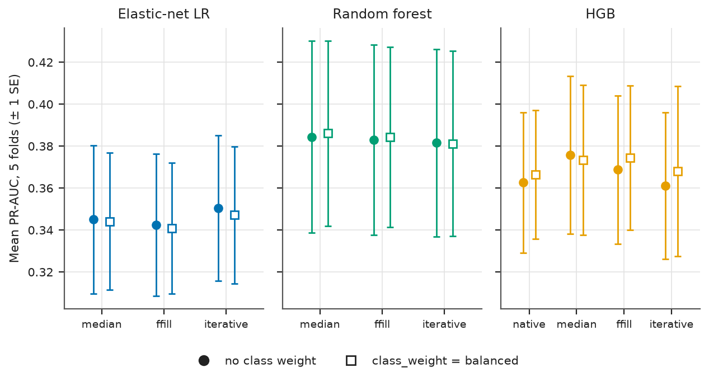

**Table 8.2: Stage 1, imputation by class weighting, rolling-origin CV on the pool.**

| Model | Imputation | Class weight | Mean PR-AUC | SE | Mean ROC-AUC | Mean Brier |
| :--- | :--- | :--- | ---: | ---: | ---: | ---: |
| Elastic-net logistic regression | median + indicators | none | 0.345 | 0.035 | 0.597 | 0.199 |
| Elastic-net logistic regression | median + indicators | balanced | 0.344 | 0.033 | 0.598 | 0.242 |
| Elastic-net logistic regression | forward fill + median | none | 0.342 | 0.034 | 0.595 | 0.200 |
| Elastic-net logistic regression | forward fill + median | balanced | 0.341 | 0.031 | 0.596 | 0.242 |
| Elastic-net logistic regression | iterative (BayesianRidge) | none | 0.350 | 0.035 | 0.602 | 0.198 |
| Elastic-net logistic regression | iterative (BayesianRidge) | balanced | 0.347 | 0.033 | 0.601 | 0.241 |
| Random forest | median + indicators | none | 0.384 | 0.046 | 0.627 | 0.194 |
| Random forest | median + indicators | balanced | 0.386 | 0.044 | 0.632 | 0.216 |
| Random forest | forward fill + median | none | 0.383 | 0.045 | 0.626 | 0.194 |
| Random forest | forward fill + median | balanced | 0.384 | 0.043 | 0.631 | 0.216 |
| Random forest | iterative (BayesianRidge) | none | 0.382 | 0.045 | 0.627 | 0.194 |
| Random forest | iterative (BayesianRidge) | balanced | 0.381 | 0.044 | 0.628 | 0.217 |
| Gradient boosting (HGB) | native NaN | none | 0.363 | 0.034 | 0.617 | 0.202 |
| Gradient boosting (HGB) | native NaN | balanced | 0.367 | 0.031 | 0.619 | 0.223 |
| Gradient boosting (HGB) | median + indicators | none | 0.376 | 0.037 | 0.622 | 0.200 |
| Gradient boosting (HGB) | median + indicators | balanced | 0.373 | 0.036 | 0.619 | 0.223 |
| Gradient boosting (HGB) | forward fill + median | none | 0.369 | 0.035 | 0.618 | 0.201 |
| Gradient boosting (HGB) | forward fill + median | balanced | 0.374 | 0.034 | 0.623 | 0.222 |
| Gradient boosting (HGB) | iterative (BayesianRidge) | none | 0.361 | 0.035 | 0.611 | 0.203 |
| Gradient boosting (HGB) | iterative (BayesianRidge) | balanced | 0.368 | 0.041 | 0.617 | 0.224 |

### 8.3 Model comparison and selection in cross-validation

The tuned settings are in Table 8.3, and Table 8.4 and Figure 8.2 compare the models. The random forest had the highest mean PR-AUC (0.384, standard error 0.051). The logistic regression scored 0.346, above the "within one standard error" cut-off of 0.334, so the rule selected the **elastic-net logistic regression**. All three beat persistence (0.290) and the prior (0.276), but folds vary a lot (fold standard deviation 0.114 for the random forest).

**Table 8.3: Preprocessing and tuned hyper-parameters per model.**

| Model | Imputation | Class weight | Tuned hyper-parameters (stage 2) |
| :--- | :--- | :--- | :--- |
| Elastic-net logistic regression | median | none | l1_ratio = 0.7, C = 3 |
| Random forest | median | none | n_estimators = 500, min_samples_leaf = 40, max_features = sqrt, max_depth = 5 |
| Gradient boosting (HGB) | native | none | min_samples_leaf = 50, max_leaf_nodes = 8, max_iter = 400, max_depth = 6, learning_rate = 0.01, l2_regularization = 1 |

**Table 8.4: Rolling-origin CV results (five folds). Brier and ECE are not shown for the persistence rule, which gives only 0 or 1.**

| Model | Mean PR-AUC | SE | Mean ROC-AUC | Mean Brier | Mean ECE |
| :--- | ---: | ---: | ---: | ---: | ---: |
| Elastic-net logistic regression | 0.346 | 0.035 | 0.597 | 0.200 | 0.075 |
| Random forest | 0.384 | 0.051 | 0.624 | 0.193 | 0.059 |
| Gradient boosting (HGB) | 0.380 | 0.038 | 0.626 | 0.197 | 0.083 |
| Persistence rule | 0.290 | 0.023 | 0.528 | n/a | n/a |
| Prior (majority) baseline | 0.276 | 0.020 | 0.500 | 0.200 | 0.032 |

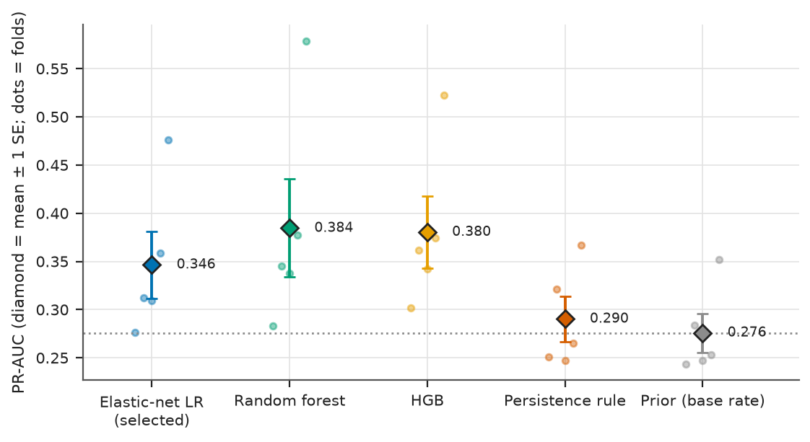

The paired bootstrap on pooled out-of-fold predictions (Table 8.5) is sharper than the fold standard errors. It says the random forest is better than the logistic regression in CV (difference -0.043, interval -0.068 to -0.015) and that every trained model beats persistence. The rule is more conservative than this bootstrap and was not changed afterwards. The country-grouped check (Table 8.6) scores every model higher, partly because it lets years mix, but orders them the same way.

**Table 8.5: Paired differences in pooled out-of-fold PR-AUC.**

| Pooled OOF PR-AUC difference | Difference | 95% country-clustered CI |
| :--- | ---: | ---: |
| Elastic-net logistic regression minus Random forest | -0.043 | [-0.068, -0.015] |
| Elastic-net logistic regression minus Gradient boosting (HGB) | -0.031 | [-0.059, -0.004] |
| Elastic-net logistic regression minus Persistence rule | +0.053 | [+0.027, +0.084] |
| Random forest minus Gradient boosting (HGB) | +0.012 | [-0.007, +0.029] |
| Random forest minus Persistence rule | +0.097 | [+0.061, +0.133] |
| Gradient boosting (HGB) minus Persistence rule | +0.085 | [+0.051, +0.123] |

**Table 8.6: Secondary check, five folds grouped by country (time ignored).**

| Model | Mean PR-AUC, grouped by country | SE | Mean ROC-AUC |
| :--- | ---: | ---: | ---: |
| Elastic-net logistic regression | 0.370 | 0.017 | 0.628 |
| Random forest | 0.427 | 0.022 | 0.654 |
| Gradient boosting (HGB) | 0.405 | 0.024 | 0.644 |
| Persistence rule | 0.285 | 0.013 | 0.534 |
| Prior (majority) baseline | 0.268 | 0.008 | 0.500 |

The frozen threshold for the elastic-net logistic regression was 0.124; on pooled out-of-fold predictions it gave recall 93%, precision 30% and MCC 0.114, so for this weakly separating model the F1 rule chose "flag almost everything".

### 8.4 The single test run

The configuration was frozen on 2026-11-05 12:33:54 UTC and the test years were evaluated once, on 2026-11-05 12:47:59 UTC. Table 8.7 gives threshold-free metrics with 95% country-clustered intervals; Table 8.8 gives metrics at the frozen thresholds. Curves, confusion matrices and reliability curves are in Figures 8.3 to 8.6 and Table 8.9.

**Table 8.7: Test results, threshold-free metrics (t = 2017-2019).**

| Model | PR-AUC [95% CI] | ROC-AUC [95% CI] | Brier score [95% CI] | ECE [95% CI] |
| :--- | ---: | ---: | ---: | ---: |
| Elastic-net logistic regression | 0.390 [0.310, 0.495] | 0.688 [0.623, 0.751] | 0.176 [0.157, 0.196] | 0.069 [0.050, 0.115] |
| Random forest | 0.471 [0.372, 0.575] | 0.700 [0.638, 0.759] | 0.168 [0.150, 0.187] | 0.051 [0.029, 0.095] |
| Gradient boosting (HGB) | 0.467 [0.368, 0.564] | 0.696 [0.638, 0.754] | 0.169 [0.149, 0.189] | 0.032 [0.023, 0.079] |
| Persistence rule | 0.284 [0.228, 0.340] | 0.568 [0.522, 0.615] | n/a | n/a |
| Prior (majority) baseline | 0.249 [0.205, 0.295] | 0.500 [0.500, 0.500] | 0.187 [0.167, 0.209] | 0.018 [0.002, 0.062] |

**Table 8.8: Test results at the frozen thresholds.**

| Model | Threshold | F1 [95% CI] | MCC [95% CI] | Precision [95% CI] | Recall [95% CI] | Balanced accuracy [95% CI] | Accuracy [95% CI] |
| :--- | ---: | ---: | ---: | ---: | ---: | ---: | ---: |
| Elastic-net logistic regression | 0.124 | 0.405 [0.344, 0.460] | 0.072 [0.010, 0.116] | 0.254 [0.208, 0.300] | 0.993 [0.977, 1.000] | 0.513 [0.501, 0.527] | 0.273 [0.227, 0.318] |
| Random forest | 0.197 | 0.436 [0.371, 0.498] | 0.172 [0.097, 0.246] | 0.285 [0.233, 0.337] | 0.926 [0.873, 0.970] | 0.578 [0.543, 0.616] | 0.404 [0.352, 0.461] |
| Gradient boosting (HGB) | 0.173 | 0.451 [0.385, 0.511] | 0.213 [0.145, 0.278] | 0.297 [0.244, 0.350] | 0.939 [0.889, 0.979] | 0.601 [0.567, 0.635] | 0.431 [0.380, 0.485] |
| Persistence rule | 0.500 | 0.362 [0.287, 0.433] | 0.130 [0.043, 0.218] | 0.337 [0.257, 0.413] | 0.392 [0.309, 0.480] | 0.568 [0.522, 0.615] | 0.657 [0.613, 0.700] |
| Prior (majority) baseline | 0.500 | 0.000 [0.000, 0.000] | 0.000 [0.000, 0.000] | 0.000 [0.000, 0.000] | 0.000 [0.000, 0.000] | 0.500 [0.500, 0.500] | 0.751 [0.705, 0.795] |

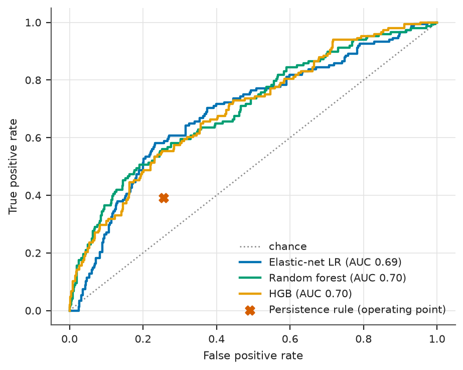

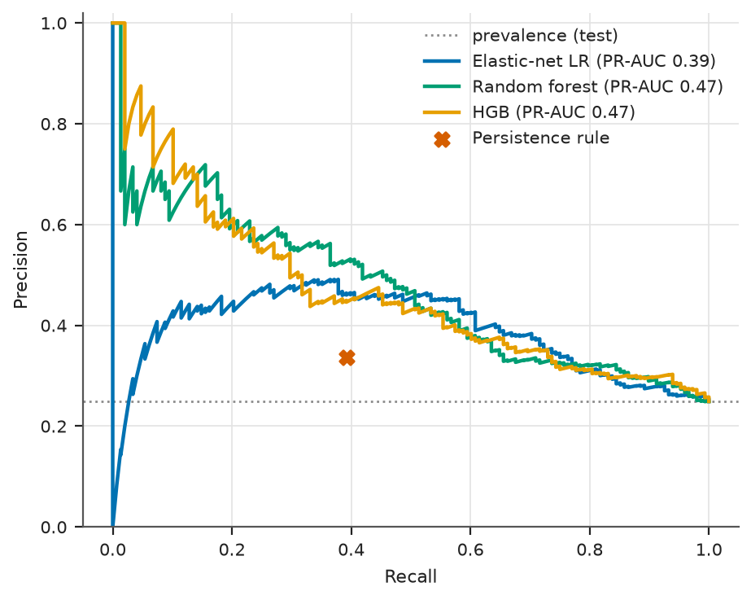

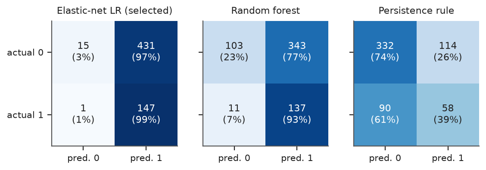

**Table 8.9: Test confusion matrices at the frozen thresholds (rates are shares of actual negatives for TN and FP, and of actual positives for FN and TP).**

| Model | TN | FP | FN | TP | TN rate | FP rate | FN rate | TP rate |
| :--- | ---: | ---: | ---: | ---: | ---: | ---: | ---: | ---: |
| Elastic-net logistic regression | 15 | 431 | 1 | 147 | 3% | 97% | 1% | 99% |
| Random forest | 103 | 343 | 11 | 137 | 23% | 77% | 7% | 93% |
| Gradient boosting (HGB) | 117 | 329 | 9 | 139 | 26% | 74% | 6% | 94% |
| Persistence rule | 332 | 114 | 90 | 58 | 74% | 26% | 61% | 39% |
| Prior (majority) baseline | 446 | 0 | 148 | 0 | 100% | 0% | 100% | 0% |

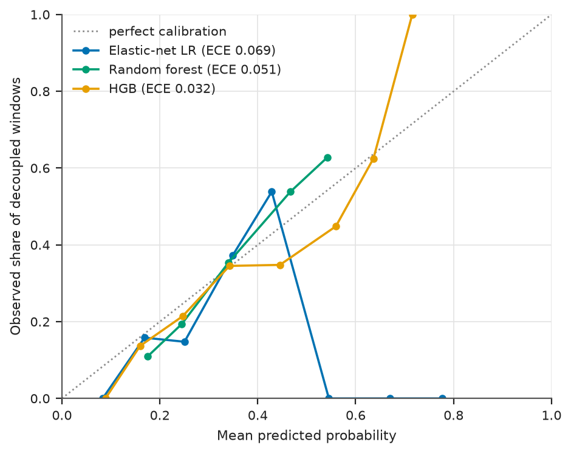

**Table 8.10: Paired differences on the test set (pre-specified comparisons).**

| Comparison on the test set | Metric | Difference | 95% country-clustered CI |
| :--- | :--- | ---: | ---: |
| Elastic-net logistic regression minus Persistence rule | PR-AUC | +0.106 | [+0.051, +0.192] |
| Elastic-net logistic regression minus Persistence rule | ROC-AUC | +0.120 | [+0.056, +0.183] |
| Elastic-net logistic regression minus Prior (majority) baseline | PR-AUC | +0.141 | [+0.084, +0.231] |
| Elastic-net logistic regression minus Prior (majority) baseline | ROC-AUC | +0.188 | [+0.123, +0.251] |
| Gradient boosting (HGB) minus Random forest | PR-AUC | -0.004 | [-0.051, +0.039] |
| Gradient boosting (HGB) minus Random forest | ROC-AUC | -0.004 | [-0.032, +0.024] |

### 8.5 Reading the test results honestly

**The model beats the simple rule.** The elastic-net logistic regression reached PR-AUC 0.390 (95% interval 0.310 to 0.495) and ROC-AUC 0.688. Persistence reached 0.284 and 0.568, and the prior 0.249. The paired PR-AUC difference from persistence was 0.106 (interval 0.051 to 0.192), which excludes zero, so the first success criterion is met for ranking. The gain is modest: a random decoupling window is ranked above a random non-decoupling one about 69% of the time.

**As a yes/no classifier at the frozen threshold it is not useful.** It made 431 false positive calls against 15 true negatives and caught 147 of 148 positives. Its accuracy (0.273) was below the prior's (0.751), its precision (0.254) about the test prevalence, and its MCC only 0.072 (interval 0.010 to 0.116), lower than persistence (0.130). It is useful for ranking, not for hard classification at this threshold.

**Part of the skill is the income gradient.** A post hoc reference (Table 8.11) scores each test row with the pool base rate of its income group, with no model at all. It reached PR-AUC 0.379 and ROC-AUC 0.689, and the logistic regression was not distinguishable from it (PR-AUC difference 0.011, interval -0.048 to 0.089). What the linear model mostly learned is the Week 2 finding that richer countries decouple more often.

**The non-linear models did better on the test set, but the choice was not changed.** The random forest scored PR-AUC 0.471 (0.372 to 0.575) and HGB 0.467 (0.368 to 0.564). In a post hoc paired comparison the PR-AUC of the logistic regression minus that of the random forest was -0.081 (interval -0.138 to -0.024), but in ROC-AUC only -0.012 (interval -0.044 to 0.025, which includes zero). The random forest also beat the income-group reference (difference 0.092, interval 0.018 to 0.172), pointing to some structure beyond income. Swapping models now would use the test set to make a choice, which the protocol forbids; the finding is a hypothesis for the next iteration.

**Table 8.11: Post hoc comparisons from the saved test predictions (exploratory, not pre-specified).**

| Comparison (post hoc) | Metric | Model A | Model B | Difference | 95% country-clustered CI |
| :--- | :--- | ---: | ---: | ---: | ---: |
| Elastic-net logistic regression minus Random forest | PR-AUC | 0.390 | 0.471 | -0.081 | [-0.138, -0.024] |
| Elastic-net logistic regression minus Random forest | ROC-AUC | 0.688 | 0.700 | -0.012 | [-0.044, +0.025] |
| Elastic-net logistic regression minus Gradient boosting (HGB) | PR-AUC | 0.390 | 0.467 | -0.077 | [-0.131, -0.011] |
| Elastic-net logistic regression minus Gradient boosting (HGB) | ROC-AUC | 0.688 | 0.696 | -0.008 | [-0.054, +0.042] |
| Elastic-net logistic regression minus Income-group prior (pool base rate of the group) | PR-AUC | 0.390 | 0.379 | +0.011 | [-0.048, +0.089] |
| Elastic-net logistic regression minus Income-group prior (pool base rate of the group) | ROC-AUC | 0.688 | 0.689 | -0.000 | [-0.062, +0.059] |
| Random forest minus Income-group prior (pool base rate of the group) | PR-AUC | 0.471 | 0.379 | +0.092 | [+0.018, +0.172] |
| Random forest minus Income-group prior (pool base rate of the group) | ROC-AUC | 0.700 | 0.689 | +0.011 | [-0.051, +0.068] |
| Persistence rule minus Income-group prior (pool base rate of the group) | PR-AUC | 0.284 | 0.379 | -0.095 | [-0.153, -0.042] |
| Persistence rule minus Income-group prior (pool base rate of the group) | ROC-AUC | 0.568 | 0.689 | -0.121 | [-0.186, -0.058] |

**Calibration** was acceptable, not excellent: test ECE was 0.069 for the logistic regression, 0.051 for the random forest and 0.032 for HGB, against 0.018 for the constant prior. The curves (Figure 8.6) over-predict in the 0.2 to 0.3 band and under-predict above 0.4.

### 8.6 Interpretation

On the test set, shuffling `ln_gdp_pc` cost 0.179 of PR-AUC, followed by `oil_share` (0.086), `ln_co2_pc` (0.048) and `ln_co2_per_gdp` (0.045) (Table 8.12). In CV the leaders were `ln_gdp_pc` (0.060), `urban_pct` (0.033) and `oil_share` (0.028), though the first was positive in only 3 of five folds.

**Table 8.12: Permutation importance of the selected model (drop in PR-AUC).**

| Feature (top 8 in CV) | CV importance (SD over folds) | Folds with positive importance of 5 | Test importance (SD over 20 shuffles) |
| :--- | ---: | ---: | ---: |
| ln_gdp_pc | 0.060 (0.086) | 3 | 0.179 (0.011) |
| urban_pct | 0.033 (0.008) | 5 | 0.002 (0.014) |
| oil_share | 0.028 (0.026) | 4 | 0.086 (0.010) |
| ln_co2_per_gdp | 0.019 (0.025) | 3 | 0.045 (0.013) |
| ln_co2_pc | 0.018 (0.021) | 3 | 0.048 (0.023) |
| industry_pct | 0.014 (0.013) | 5 | 0.037 (0.011) |
| co2_per_unit_energy | 0.008 (0.004) | 4 | 0.003 (0.004) |
| co2_chg1 | 0.007 (0.007) | 5 | -0.003 (0.008) |

The L1 part of the penalty zeroed only 1 of 32 columns (a missing-indicator column), so the penalty acted mostly as shrinkage (Table 8.13). The largest coefficients are `ln_gdp_pc` (1.62), `ln_co2_pc` (-1.58) and `ln_co2_per_gdp` (0.75). They are tied by the identity in Section 4.1 and must be read together: high income with low emissions per person raises the odds of decoupling. Only 6 of the 16 features with a pre-specified sign had a coefficient of that sign; correlated features make single signs unreliable. Partial dependence moved most for GDP per person (predicted probability from 0.05 to 0.75 across its 5th to 95th percentile), then oil share (0.20 to 0.38) and urbanisation (0.22 to 0.31). These are predictive associations at country level, not causes.

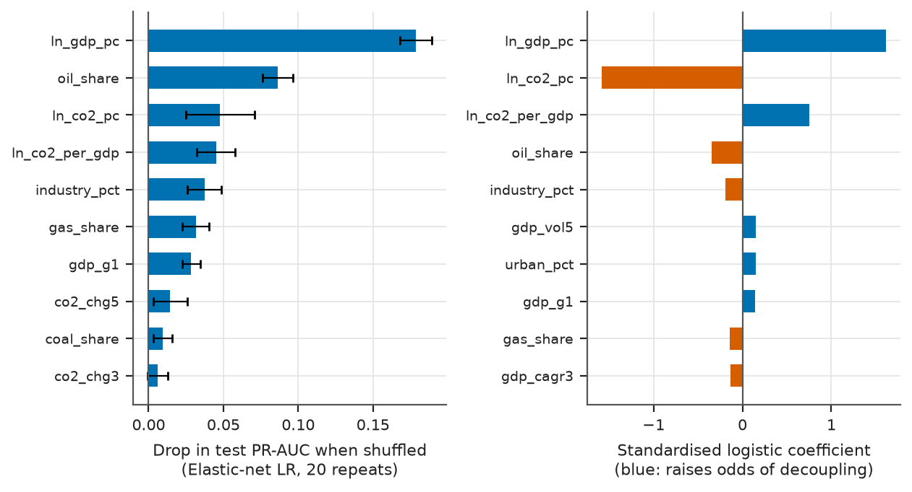

**Table 8.13: Standardised logistic coefficients on the pool and agreement with the pre-specified expected signs.**

| Feature | Standardised coefficient | Expected sign (plan) | Observed versus expected |
| :--- | ---: | :--- | :--- |
| ln_gdp_pc | +1.617 | + | agrees |
| ln_co2_pc | -1.582 | + | opposite |
| ln_co2_per_gdp | +0.751 | - | opposite |
| oil_share | -0.347 | ? | no prior |
| industry_pct | -0.188 | - | agrees |
| gdp_vol5 | +0.153 | - | opposite |
| urban_pct | +0.152 | ? | no prior |
| gdp_g1 | +0.145 | + | agrees |
| gas_share | -0.144 | + | opposite |
| gdp_cagr3 | -0.134 | + | opposite |
| co2_chg5 | -0.124 | - | agrees |
| co2_chg1 | +0.115 | - | opposite |
| ci_chg3 | +0.098 | - | opposite |
| co2_chg3 | -0.077 | - | agrees |
| ln_energy_per_gdp | +0.066 | - | opposite |
| co2_per_unit_energy | +0.041 | - | opposite |
| coal_share | -0.036 | - | agrees |
| ln_pop | +0.009 | ? | no prior |
| pop_g3 | +0.006 | - | opposite |

### 8.7 Subgroups

The selected model's PR-AUC was 0.50 for high-income countries, whose prevalence was 43%: only a small improvement where decoupling is most common (Figure 8.8, Table 8.14). For upper-middle income it was 0.23 against 15%; for lower-middle income 0.15 against 17%, with ROC-AUC 0.46, below 0.5. Low income had only 6 positive windows, Sub-Saharan Africa a ROC-AUC of 0.48, and North America (9 rows) and South Asia (18 rows) are too small to read. Skill lies in separating income groups from each other; within most groups it is close to chance, and intervals are wide.

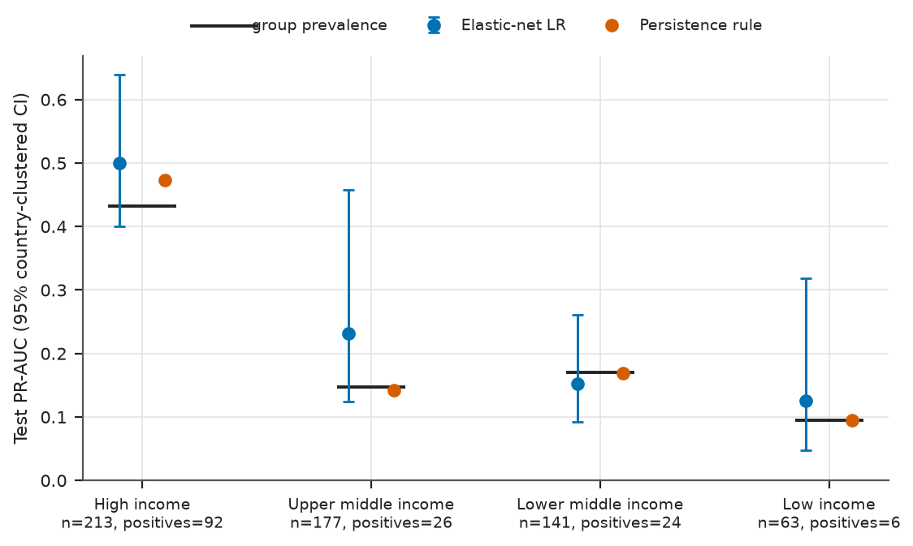

**Table 8.14: Test performance by income group and region of the selected model.**

| Group | Rows | Countries | Positives | Prevalence | Elastic-net logistic regression PR-AUC [95% CI] | Persistence PR-AUC | Elastic-net logistic regression ROC-AUC |
| :--- | ---: | ---: | ---: | ---: | ---: | ---: | ---: |
| High income | 213 | 71 | 92 | 43% | 0.50 [0.40, 0.64] | 0.47 | 0.64 |
| Low income | 63 | 21 | 6 | 10% | 0.13 [0.05, 0.32] | 0.10 | 0.53 |
| Lower middle income | 141 | 47 | 24 | 17% | 0.15 [0.09, 0.26] | 0.17 | 0.46 |
| Upper middle income | 177 | 59 | 26 | 15% | 0.23 [0.12, 0.46] | 0.14 | 0.62 |
| East Asia & Pacific | 96 | 32 | 24 | 25% | 0.31 [0.15, 0.61] | 0.26 | 0.60 |
| Europe & Central Asia | 156 | 52 | 77 | 49% | 0.60 [0.51, 0.71] | 0.53 | 0.63 |
| Latin America & Caribbean | 111 | 37 | 14 | 13% | 0.18 [0.09, 0.39] | 0.12 | 0.60 |
| Middle East, North Africa, Afghanistan & Pakistan | 66 | 22 | 9 | 14% | 0.29 [0.11, 0.61] | 0.16 | 0.64 |
| North America | 9 | 3 | 5 | 56% | 0.84 | 0.57 | 0.70 |
| South Asia | 18 | 6 | 1 | 6% | 0.12 [0.08, 0.33] | 0.06 | 0.59 |
| Sub-Saharan Africa | 138 | 46 | 18 | 13% | 0.14 [0.07, 0.29] | 0.13 | 0.48 |

### 8.8 Ablation and robustness

With momentum features only (set A) the logistic regression scored a test PR-AUC of 0.255, no better than the prior (0.249). Adding economic structure (set B) raised it to 0.350, and energy and fuel mix (set C) to 0.390; in CV the sets scored 0.301, 0.344 and 0.346. L1 selection on top of C made no difference (0.390). A country's recent trajectory alone carries almost no information about the next three years, as the persistence rule also shows.

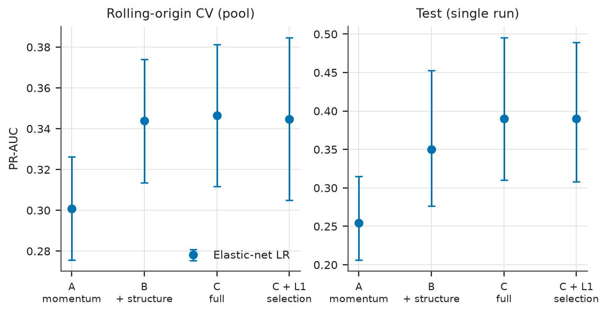

**Table 8.15: Feature-set ablation (fixed tuned hyper-parameters).**

| Model | Feature set | Features | CV mean PR-AUC (SE) | Test PR-AUC [95% CI] |
| :--- | :--- | ---: | ---: | ---: |
| Elastic-net logistic regression | A | 6 | 0.301 (0.025) | 0.255 [0.206, 0.315] |
| Elastic-net logistic regression | B | 14 | 0.344 (0.030) | 0.350 [0.277, 0.453] |
| Elastic-net logistic regression | C | 20 | 0.346 (0.035) | 0.390 [0.310, 0.495] |
| Elastic-net logistic regression | C+L1 | 20 | 0.345 (0.040) | 0.390 [0.308, 0.490] |

Excluding the window ending in 2020 (t = 2017) raised every score but kept the ordering: PR-AUC 0.485 for the logistic regression against 0.331 for persistence. Excluding countries under one million people gave 0.456 against 0.311. With a five-year horizon in CV, the logistic regression's mean fold PR-AUC was 0.375 (persistence 0.296, prior 0.283), against 0.346 at three years. The selected model stays ahead of persistence in every variant.

**Table 8.16: Test robustness variants (subsets of the single test run).**

| Variant | Model | Rows | Positives | PR-AUC [95% CI] | ROC-AUC | F1 | MCC |
| :--- | :--- | ---: | ---: | ---: | ---: | ---: | ---: |
| primary (t = 2017-2019) | Elastic-net logistic regression | 594 | 148 | 0.390 [0.310, 0.495] | 0.688 | 0.405 | 0.072 |
| primary (t = 2017-2019) | Persistence rule | 594 | 148 | 0.284 [0.228, 0.340] | 0.568 | 0.362 | 0.130 |
| primary (t = 2017-2019) | Prior (majority) baseline | 594 | 148 | 0.249 [0.205, 0.295] | 0.500 | 0.000 | 0.000 |
| exclude t = 2017 (window ends 2020) | Elastic-net logistic regression | 396 | 105 | 0.485 [0.383, 0.618] | 0.748 | 0.425 | 0.073 |
| exclude t = 2017 (window ends 2020) | Persistence rule | 396 | 105 | 0.331 [0.260, 0.405] | 0.611 | 0.437 | 0.211 |
| exclude t = 2017 (window ends 2020) | Prior (majority) baseline | 396 | 105 | 0.265 [0.215, 0.316] | 0.500 | 0.000 | 0.000 |
| exclude population < 1 million | Elastic-net logistic regression | 465 | 129 | 0.456 [0.363, 0.571] | 0.720 | 0.441 | 0.076 |
| exclude population < 1 million | Persistence rule | 465 | 129 | 0.311 [0.249, 0.382] | 0.565 | 0.381 | 0.125 |
| exclude population < 1 million | Prior (majority) baseline | 465 | 129 | 0.277 [0.228, 0.333] | 0.500 | 0.000 | 0.000 |

**Table 8.17: Robustness in cross-validation (pooled out-of-fold subset, and the five-year horizon with fold means).**

| Variant | Model | Rows | Base rate | PR-AUC | ROC-AUC |
| :--- | :--- | ---: | ---: | ---: | ---: |
| exclude population < 1 million (OOF subset) | Elastic-net logistic regression | 2,293 | 28.8% | 0.352 | 0.597 |
| primary (all OOF rows) | Elastic-net logistic regression | 2,948 | 27.6% | 0.342 | 0.599 |
| exclude population < 1 million (OOF subset) | Persistence rule | 2,293 | 28.8% | 0.301 | 0.527 |
| primary (all OOF rows) | Persistence rule | 2,948 | 27.6% | 0.289 | 0.528 |
| exclude population < 1 million (OOF subset) | Prior (majority) baseline | 2,293 | 28.8% | 0.297 | 0.526 |
| primary (all OOF rows) | Prior (majority) baseline | 2,948 | 27.6% | 0.284 | 0.524 |
| horizon h=5 (rolling-origin, 4 folds, 5-year purge) | Elastic-net logistic regression | 3,692 | 27.2% | 0.375 | 0.599 |
| horizon h=5 (rolling-origin, 4 folds, 5-year purge) | Persistence rule | 3,692 | 27.2% | 0.296 | 0.528 |
| horizon h=5 (rolling-origin, 4 folds, 5-year purge) | Prior (majority) baseline | 3,692 | 27.2% | 0.283 | 0.500 |

## 9. Potential pitfalls and mitigation

### 9.1 Risk register

Table 9.1 is the risk register written into the plan, with a column that says what happened in this data. Several risks mattered: the weak signal made the threshold unreliable, the one-standard-error rule and the test set disagreed about the best model, and income-group information accounted for much of the skill.

**Table 9.1: Risk register with the outcome observed in this project.**

| Risk | Why it matters here | Mitigation | What happened in this data |
| :--- | :--- | :--- | :--- |
| Temporal leakage (future information reaching the model) | A model that sees later years looks better than it is and fails in use | Features use data at t and earlier; pool, purge and test split; rolling-origin CV with a purge gap; imputers, scalers and limits fitted inside folds | A test perturbs all data after a cut-off and no feature changes. CV scores are modest (best mean PR-AUC 0.384), which is not the pattern a leak produces. |
| Label overlap between adjacent windows | Windows at t and t+1 share two years, so rows are not independent and validation can echo training | Three-year purge between training and validation blocks; whole-country bootstrap | Purge gaps verified by test 19. Paired CV differences carry wide country-clustered intervals, for example logistic regression minus random forest -0.043 [-0.068, -0.015]. |
| Country leakage (the same country on both sides of a split) | The model can recognise a country instead of learning a general pattern | No country identifier as a feature; secondary country-grouped CV; clustered bootstrap | Grouped CV gave higher scores than rolling-origin CV (logistic regression 0.370 versus 0.346, random forest 0.427 versus 0.384). Because grouped folds also mix years, this shows how optimistic time-blind splitting would have been. |
| COVID-19 distribution shift | Windows ending in 2020-2022 span an unusual recession and rebound | Base rate by year; primary test on t = 2017-2019; variant without t = 2017 | Test base rates were 21.7%, 22.7% and 30.3% for t = 2017, 2018, 2019. Dropping t = 2017 raised logistic-regression PR-AUC to 0.485 (persistence 0.331); the ordering of methods did not change. |
| Class imbalance | About three rows in four are negatives; accuracy rewards predicting nothing | PR-AUC for selection; MCC and balanced accuracy reported; class weights compared; no SMOTE | Balanced weighting did not win the pre-specified rule for any model; for the logistic regression mean PR-AUC was 0.345 without and 0.344 with weights. |
| Missing not at random (MNAR) | Gaps in small, poor or conflict-affected countries carry information and cannot be imputed away | Audit by feature, year and group; missing-indicator flags; native NaN handling compared | 9 of 14 features with gaps differ by income group. The four imputation options scored within one standard error of each other for every model, so the choice mattered little. |
| Overfitting to the CV folds | Tuning on the same folds that score the model inflates the score | Small grids (30 draws), simplicity rule, test set kept for one run | Test scores were not lower than CV scores (logistic regression PR-AUC 0.390 on test versus 0.346 in CV), so no optimism from tuning was visible; the test base rate was also a little lower. |
| Selection bias from comparing many models | The winner of a comparison is partly lucky | Only three trained models; selection rule fixed in advance; one test run | The rule chose the simplest model within one standard error. On the test set the random forest and HGB scored higher (post hoc PR-AUC difference -0.081 for logistic regression minus random forest). The choice was not changed after seeing this. |
| Calibration drift | Probabilities can be right in one period and wrong in the next | Reliability curve, ECE and Brier score on the test; threshold fixed from CV | ECE moved from 0.055 in CV to 0.069 on test for the logistic regression; the random forest went from 0.035 to 0.051. |
| Threshold degeneracy under weak signal | The F1-maximising threshold becomes very low when the model separates classes poorly | Threshold-free metrics carry the main conclusions | The frozen logistic-regression threshold was 0.124: it flagged almost every test row (recall 0.993, precision 0.254, accuracy 0.273). |
| Small subgroups | A few countries decide a subgroup score | Show n and positives; clustered CIs; no CI for fewer than 10 rows or 3 countries | North America has 9 test rows and South Asia 18 rows with 1 positive; no conclusions are drawn for them. |
| Circular income groups | Income group is defined from income, which is already a feature | Income group never used as a feature, only to evaluate subgroups | An income-group prior scored PR-AUC 0.379 on test, almost the same as the logistic regression (0.390); see Section 8.5. |
| Ecological fallacy | Country-level patterns need not hold inside a country | Only country-level statements; no claim about people or regions inside countries | Not testable with these data; the report words all findings at country level. |
| Production-based accounting | CO2 produced inside a country excludes emissions embodied in imports | State the definition; do not claim anything about consumption | Not measured. A country can look as if it decoupled by importing carbon-intensive goods. |
| Data revisions and vintage | OWID and World Bank series are revised, so a later download can differ | Raw files hashed in a manifest; results tied to one download | All files were downloaded on 2026-11-05; test 5 checks every hash. |

### 9.2 What mattered most

**Leakage and label overlap** are the usual ways a panel model fools its author. They were handled by construction and by test; the indirect evidence that they did not occur is that scores are modest, which is not what a leak usually produces. **Selection under weak signal:** with about 4,093 correlated rows and five folds, differences of a few hundredths in PR-AUC cannot be separated from noise inside CV, which is why the rule prefers a simpler model. The test result suggests this cost some ranking quality, but a rule fixed before seeing results is worth more than one adjusted afterwards; the remedy is more evidence, not a changed rule. **Reading a modest model correctly:** a score above the baselines does not make a model useful for decisions. Here the ranking beats chance and persistence, but thresholded predictions are close to useless and a trivial income-group reference matches the linear model (Section 8.5).

## 10. Limitations and responsible use

* **Predictive association, not causation.** An importance or a coefficient does not say what would happen if a country changed that feature (Shmueli, 2010).
* **Production-based, territorial CO2.** OWID's `co2_per_capita` counts fossil-fuel and industrial CO2 emitted inside a country. A country can "decouple" by importing goods produced elsewhere, and land-use change and other gases are excluded, so absolute decoupling on this definition is not a falling climate footprint (compare Haberl et al., 2020).
* **A narrow, strict label.** A tiny fall in emissions counts the same as a large one, and an unchanged value counts as no decoupling.
* **Small, dependent sample.** The data hold 4,687 windows from 201 countries with overlapping windows, and the test set has only 148 positive windows.
* **One COVID-shaped test period.** The test windows end in 2020 to 2022 and may not describe calmer periods.
* **Current income groups** are used for subgroups, not the groups in force in each year.
* **The F1 threshold rule failed to give a useful classifier.** It was pre-specified and kept, and its weakness is part of the finding. Likewise the selection rule and the test result disagree about the best model; the post hoc analysis is exploratory and changed nothing.
* **One data vintage.** OWID and World Bank values are revised.
* **Responsible use.** The model should not rate, rank or sanction countries, set targets, or support claims that policies work. It is a teaching pipeline whose value is the process, not the predictions.

## 11. Roadmap beyond Week 3

If the model were to be used: **monitor** the base rate, score distribution and calibration as data arrive; **retrain** yearly with the same rolling-origin design and test discipline; **follow the post hoc lead** by repeating the comparison, with the random forest and boosting given more weight, on a later hold-out period, adding calibration (Platt scaling or isotonic regression fitted inside folds); and **improve the label and features** with a continuous target, consumption-based emissions and OWID's energy-mix shares. Deployment is out of scope.

## 12. Conclusion

The task was to build and evaluate a model predicting absolute decoupling of CO2 per person from GDP per person three years ahead, with a complete, leakage-safe process. The pipeline does that: a pre-specified plan, time-aware splits with a purge gap, everything fitted inside folds, a rule-based model choice, a frozen threshold and one test run; 31 integrity tests pass.

The result is modest. The selected elastic-net logistic regression reached a test PR-AUC of 0.390 (95% interval 0.310 to 0.495), against 0.284 for the persistence rule and a test prevalence of 24.9%; the paired difference from persistence (0.106, interval 0.051 to 0.192) shows that ranking by the model beats extrapolating the recent past. The limits matter as much: at the frozen threshold the model flags almost every window, an income-group prior ranks as well, and a country's recent trajectory alone predicts almost nothing beyond the base rate, while level and structure (above all income per person, then fuel mix and industry) carry the signal. The random forest and boosting scored higher on the test set in a post hoc comparison, but the pre-specified choice was not changed.

For the title question the answer is cautious. Income per person is strongly associated with whether emissions per person fall while income rises, echoing Week 2, but beyond that association a country's next three years are hard to predict from these features.

## 13. References

- Bergmeir, C., & Benítez, J. M. (2012). On the use of cross-validation for time series predictor evaluation. *Information Sciences*, 191, 192-213. https://doi.org/10.1016/j.ins.2011.12.028
- Breiman, L. (2001). Random Forests. *Machine Learning*, 45, 5-32. https://doi.org/10.1023/a:1010933404324
- Cerqueira, V., Torgo, L., & Mozetič, I. (2020). Evaluating time series forecasting models: an empirical study on performance estimation methods. *Machine Learning*, 109, 1997-2028. https://doi.org/10.1007/s10994-020-05910-7
- Chicco, D., & Jurman, G. (2020). The advantages of the Matthews correlation coefficient (MCC) over F1 score and accuracy in binary classification evaluation. *BMC Genomics*, 21, 6. https://doi.org/10.1186/s12864-019-6413-7
- Davis, J., & Goadrich, M. (2006). The relationship between Precision-Recall and ROC curves. *Proceedings of the 23rd international conference on Machine learning - ICML '06*, 233-240. https://doi.org/10.1145/1143844.1143874
- Efron, B. (1979). Bootstrap Methods: Another Look at the Jackknife. *The Annals of Statistics*, 7, 1-26. https://doi.org/10.1214/aos/1176344552
- Friedman, J. H. (2001). Greedy function approximation: A gradient boosting machine. *The Annals of Statistics*, 29, 1189-1232. https://doi.org/10.1214/aos/1013203451
- Haberl, H., Wiedenhofer, D., Virág, D., Kalt, G., Plank, B., Brockway, P., Fishman, T., Hausknost, D., Krausmann, F., Leon-Gruchalski, B., Mayer, A., Pichler, M., Schaffartzik, A., Sousa, T., Streeck, J., & Creutzig, F. (2020). A systematic review of the evidence on decoupling of GDP, resource use and GHG emissions, part II: synthesizing the insights. *Environmental Research Letters*, 15, 65003. https://doi.org/10.1088/1748-9326/ab842a
- Kapoor, S., & Narayanan, A. (2023). Leakage and the reproducibility crisis in machine-learning-based science. *Patterns*, 4, 100804. https://doi.org/10.1016/j.patter.2023.100804
- Niculescu-Mizil, A., & Caruana, R. (2005). Predicting good probabilities with supervised learning. *Proceedings of the 22nd international conference on Machine learning - ICML '05*, 625-632. https://doi.org/10.1145/1102351.1102430
- Roberts, D. R., Bahn, V., Ciuti, S., Boyce, M. S., Elith, J., Guillera‐Arroita, G., Hauenstein, S., Lahoz‐Monfort, J. J., Schröder, B., Thuiller, W., Warton, D. I., Wintle, B. A., Hartig, F., & Dormann, C. F. (2017). Cross‐validation strategies for data with temporal, spatial, hierarchical, or phylogenetic structure. *Ecography*, 40, 913-929. https://doi.org/10.1111/ecog.02881
- Saito, T., & Rehmsmeier, M. (2015). The Precision-Recall Plot Is More Informative than the ROC Plot When Evaluating Binary Classifiers on Imbalanced Datasets. *PLOS ONE*, 10, e0118432. https://doi.org/10.1371/journal.pone.0118432
- Shmueli, G. (2010). To Explain or to Predict? *Statistical Science*, 25, 289-310. https://doi.org/10.1214/10-sts330
- Zou, H., & Hastie, T. (2005). Regularization and Variable Selection Via the Elastic Net. *Journal of the Royal Statistical Society Series B: Statistical Methodology*, 67, 301-320. https://doi.org/10.1111/j.1467-9868.2005.00503.x

## Appendices

### Appendix A. Reproduction steps

All commands run from the repository root on Windows, macOS or Linux (activate the environment with `.venv\Scripts\activate` on Windows or `source .venv/bin/activate` elsewhere).

```
python -m venv .venv
pip install -r requirements.txt
python src/acquire.py              # downloads and caches raw data, writes the manifest
python src/clean.py                # cleaning, join report, column availability
python src/features.py             # label, features, sample flow
python src/evaluate_cv.py          # EDA on the pool, CV, selection, freeze (about 8 minutes)
python src/evaluate_test.py        # the single test run (about 6 minutes); refuses to run twice
python src/posthoc_test_analysis.py   # exploratory comparisons from the saved test predictions
python src/make_figures.py         # 14 figures
pytest                             # integrity tests
python report/_build/build_report.py   # regenerates report/report_content.md from results/*.csv
```

The test script is blocked by `results/test_run_lock.json`. To repeat it on a fresh clone, delete that file by hand, which is a deliberate, visible act. `python src/evaluate_test.py --rehearsal` runs the same code on a pseudo-split of the pool, for debugging only.

### Appendix B. Hyper-parameter search spaces

Each search drew 30 random combinations (`RandomizedSearchCV`, `random_state = 42`) and scored them by mean PR-AUC across the five rolling-origin folds. The logistic regression space has 66 combinations, the random forest 120 and HGB 1,728 or more.

| Model | Hyper-parameter | Values in the search space |
| :--- | :--- | :--- |
| Elastic-net logistic regression | C | 0.001, 0.003, 0.01, 0.03, 0.1, 0.3, 1, 3, 10, 30, 100 |
| Elastic-net logistic regression | l1_ratio | 0.1, 0.3, 0.5, 0.7, 0.9, 1.0 |
| Random forest | n_estimators | 300, 500 |
| Random forest | max_depth | 3, 5, 8, 12, None |
| Random forest | min_samples_leaf | 5, 10, 20, 40 |
| Random forest | max_features | sqrt, 0.3, 0.5 |
| Gradient boosting (HGB) | learning_rate | 0.01, 0.03, 0.05, 0.1 |
| Gradient boosting (HGB) | max_depth | 2, 3, 4, 6 |
| Gradient boosting (HGB) | max_leaf_nodes | 8, 15, 31 |
| Gradient boosting (HGB) | min_samples_leaf | 20, 50, 100 |
| Gradient boosting (HGB) | l2_regularization | 0, 0.1, 1, 10 |
| Gradient boosting (HGB) | max_iter | 100, 200, 400 |

### Appendix C. Full feature catalogue

Summary statistics are computed on the training pool only.

| Feature | Group | Median | 1st percentile | 99th percentile | Missing in pool |
| :--- | :--- | ---: | ---: | ---: | ---: |
| ln_gdp_pc | economic | 8.331 | 5.545 | 11.333 | 0.0% |
| gdp_g1 | economic | 0.023 | -0.159 | 0.156 | 0.3% |
| gdp_cagr3 | economic | 0.021 | -0.138 | 0.133 | 0.8% |
| gdp_vol5 | economic | 0.026 | 0.004 | 0.227 | 2.2% |
| ln_pop | economic | 15.637 | 9.305 | 20.644 | 0.0% |
| pop_g3 | economic | 0.014 | -0.017 | 0.060 | 0.0% |
| urban_pct | economic | 55.631 | 13.014 | 100.000 | 0.0% |
| industry_pct | economic | 24.898 | 5.337 | 71.331 | 8.5% |
| ln_co2_pc | emissions | 0.863 | -3.219 | 3.479 | 0.0% |
| co2_chg1 | emissions | 0.011 | -0.335 | 0.372 | 0.0% |
| co2_chg3 | emissions | 0.032 | -0.595 | 0.618 | 0.3% |
| co2_chg5 | emissions | 0.053 | -0.869 | 0.881 | 0.7% |
| ln_co2_per_gdp | emissions | -7.925 | -9.528 | -5.703 | 0.0% |
| ci_chg3 | emissions | -0.031 | -0.572 | 0.591 | 1.0% |
| ln_energy_pc | energy mix | 9.225 | 5.231 | 11.996 | 3.5% |
| ln_energy_per_gdp | energy mix | 0.200 | -1.701 | 1.946 | 18.3% |
| co2_per_unit_energy | energy mix | 214.948 | 70.415 | 842.457 | 3.5% |
| coal_share | energy mix | 0.121 | 0.000 | 0.844 | 34.2% |
| oil_share | energy mix | 0.662 | 0.109 | 1.000 | 0.1% |
| gas_share | energy mix | 0.181 | 0.000 | 0.842 | 41.2% |

### Appendix D. Integrity tests

The suite in `tests/test_pipeline_integrity.py` has 31 checks, all passing.

| No. | Check | Detail |
| ---: | :--- | :--- |
| 01 | No duplicate iso3 year in panel and dataset |  |
| 02 | No aggregates in panel |  |
| 03 | Kosovo crosswalk applied |  |
| 04 | Iso3 join completeness |  |
| 05 | Raw files match manifest |  |
| 06 | Core series never imputed | CO2pc and GDPpc of eligible rows are observed values (strictly positive), never filled. |
| 07 | Log guard and finite features |  |
| 08 | Share features in unit interval |  |
| 09 | Label hand made examples |  |
| 10 | Label uses only t and t plus h |  |
| 11 | Persistence rule hand example |  |
| 12 | Label base rate within bounds |  |
| 13 | Features do not use data after t |  |
| 14 | Features hand computed |  |
| 15 | Forward fill is past only and limited to two years |  |
| 16 | Forbidden features not used |  |
| 17 | Train purge test periods do not overlap |  |
| 18 | Test years absent from selection outputs | Selection code never touches the test years: pool, OOF file and source text all clean. |
| 19 | Rolling origin folds have purge gap |  |
| 20 | Group folds never share a country |  |
| 21 | Imputer scaler and winsorizer fitted on training fold only |  |
| 22 | Correlation filter uses training fold and drops duplicates |  |
| 23 | Seed reproducibility |  |
| 24 | No smote in source | SMOTE is deliberately not used on time-ordered panel data. |
| 25 | Metrics known values |  |
| 26 | Cluster bootstrap resamples whole countries |  |
| 27 | Sample flow matches dataset |  |
| 28 | Frozen config complete and before test run |  |
| 29 | Test run used frozen threshold and test rows only |  |
| 30 | Report has no placeholders and clean tables | No placeholder words, LF line endings, and every table row has the same number of cells as its header. |
| 31 | Figures exist and are not tall |  |
